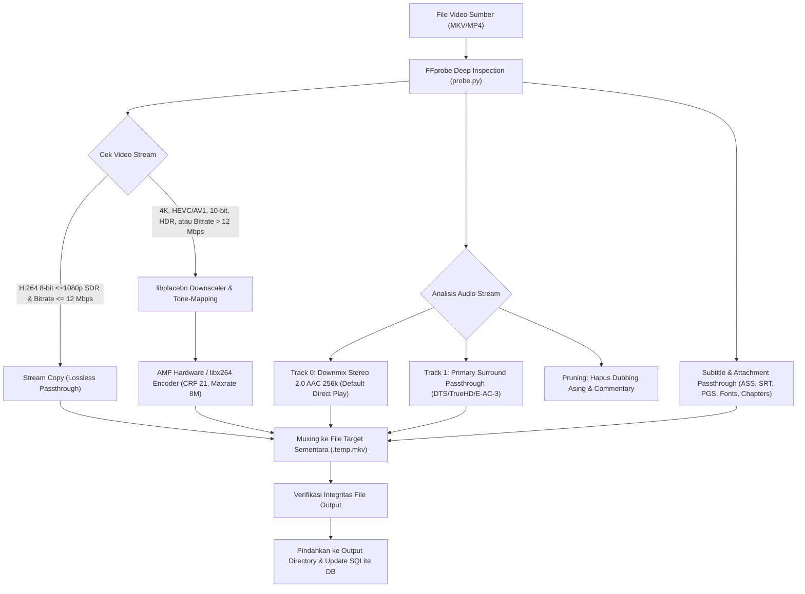

# Jellyfin Media Transcoder & Direct Play Optimizer

Aplikasi otomasi transcoding media berbasis **Python** dan **FFmpeg** dengan antarmuka web modern untuk mengoptimalkan koleksi video (film, serial TV, anime, remux 4K UHD/1080p) agar dapat diputar secara **Direct Play** (tanpa transcoding beban kerja tinggi secara real-time di server) pada **Jellyfin Media Server**, web browser, TV, dan perangkat mobile.

---

## Daftar Isi

- [Latar Belakang & Masalah](#latar-belakang--masalah)
- [Fitur Utama](#fitur-utama)
- [Alur Pipeline Transcoding](#alur-pipeline-transcoding)
- [Struktur Proyek](#struktur-proyek)
- [Prasyarat Sistem](#prasyarat-sistem)
- [Instalasi & Menjalankan](#instalasi--menjalankan)
- [Panduan Penggunaan Antarmuka Web](#panduan-penggunaan-antarmuka-web)
- [Konfigurasi Teknis FFmpeg](#konfigurasi-teknis-ffmpeg)
- [Lisensi](#lisensi)

---

## Latar Belakang & Masalah

Pada ekosistem Jellyfin Media Server, media berkualitas tinggi seperti **4K HDR HEVC 10-bit**, **Remux Blu-Ray** dengan bitrate sangat tinggi (>30 Mbps), atau file dengan audio multikanal seperti **DTS-HD MA** dan **Dolby TrueHD** sering kali memicu *transcoding on-the-fly* di sisi server saat diputar di browser web atau perangkat yang tidak mendukung codec tersebut. Hal ini mengakibatkan:
1. Lonjakan beban CPU/GPU server Proxmox atau NAS.
2. *Buffering* atau jeda pemutaran pada jaringan lokal/remote.
3. Pemborosan ruang penyimpanan akibat audio dubbing multi-bahasa yang tidak ditonton.

**Jellyfin Media Transcoder** menyelesaikan masalah ini dengan pra-konversi terstruktur: mengubah video menjadi **H.264 SDR 1080p** dengan downscaling berkualitas tinggi (*EWA Lanczos*), menambahkan audio default **Stereo 2.0 AAC** untuk Direct Play universal, sekaligus mempertahankan stream surround utama untuk pengalaman home theater.

---

## Fitur Utama

### 1. High-End Video Pipeline (libplacebo & Tone-Mapping)
- **Downscaling Presisi Tinggi**: Menggunakan filter `libplacebo` dengan algoritma **EWA Lanczos (Jinc)**, sigmoid color curve, dan anti-ringing clamping (`0.8`) untuk menjaga ketajaman gambar tanpa artefak halo.
- **HDR to SDR Tone-Mapping**: Algoritma spline tone-mapping dengan deteksi puncak otomatis (*peak detection*), mentransformasikan gamut warna BT.2020 HDR ke standar BT.709 8-bit YUV420p tanpa membuat gambar tampak pudar (*washed-out*).
- **VBV Rate Control**: Dilengkapi pembatas laju bit puncak (`-maxrate 8000k -bufsize 16000k`) pada mode CQP/CRF untuk mencegah lonjakan ukuran file ekstrem pada adegan dengan noise film (*film grain*).
- **Smart Stream Copy (Passthrough)**: Jika video sumber sudah berformat H.264 8-bit ≤1080p SDR dengan bitrate wajar (≤12 Mbps), stream video disalin secara langsung (**lossless**) tanpa membuang waktu dan daya untuk encoding ulang.

### 2. Dual-Track Audio Architecture & Intelligent Pruning
- **Track 0 (Default - Direct Play)**: Downmix Stereo 2.0 AAC 256 kbps dari audio utama/asli agar video langsung terputar mulus di browser web, iOS, Android, dan smart TV tanpa transcoding server.
- **Track 1 (Surround Passthrough)**: Menyalin stream audio multikanal utama asli (DTS-HD MA, TrueHD, E-AC-3, AC-3 5.1/7.1) secara utuh untuk perangkat home theater dan soundbar.
- **Audio Dubbing Pruning**: Menghapus audio dubbing asing (Rusia, Spanyol, Prancis, dll.) serta track komentar audio secara otomatis, menghemat ruang disk hingga belasan gigabyte per film.
- **Pelestarian Audio Bahasa Indonesia**: Tetap mempertahankan audio berbahasa Indonesia jika ditemukan pada stream audio sekunder.

### 3. Preservasi Subtitle & Metadata Penuh
- Menyalin seluruh stream subtitle bawaan (SRT, ASS/SSA, PGS) secara utuh (`-map 0:s? -c:s copy`).
- Menyalin lampiran font grafis anime/film (`-map 0:t? -c:t copy`).
- Mempertahankan penanda babak (*chapters*) dan seluruh metadata global video.

### 4. Scanner Subtitle Bahasa Indonesia
- Pemindai otomatis terintegrasi untuk mendeteksi ketersediaan subtitle Bahasa Indonesia internal (`id`, `ind`, `indonesian`) maupun berkas eksternal (`.id.srt`, `.ind.srt`).
- Menyediakan indikator visual pada antarmuka web untuk berkas yang belum memiliki subtitle Bahasa Indonesia.

### 5. Akselerasi Perangkat Keras (Hardware Acceleration)
- Mendukung encoder perangkat keras **AMD AMF** (`h264_amf` via `d3d11va`) yang dioptimalkan untuk GPU AMD Radeon.
- Fallback otomatis ke encoder CPU standar industri **x264** (`libx264`).

### 6. Dashboard Web & Queue Manager
- Antarmuka web responsif dan interaktif di port `5500`.
- Telemetri utilisasi ruang disk, estimasi penghematan kapasitas, dan spesifikasi hardware.
- Sistem antrean transcoding otomatis (Start, Pause, Resume, Clear, Reset File).
- Filter status berkas: *All*, *Needs Transcode*, *Ready (Direct Play)*, *In Queue*, *Completed*, *Failed*, dan *Missing Indo Sub*.

---

## Alur Pipeline Transcoding



---

## Struktur Proyek

```text
jellyfin-converter/
├── database.py         # Skema database SQLite (WAL Mode), migrasi, dan query CRUD
├── probe.py            # Analisis metadata media (FFprobe), deteksi HDR, seleksi audio
├── queue_manager.py    # Worker thread antrean transcode dengan tracking progress
├── run.bat             # Skrip peluncur satu-klik untuk lingkungan Windows
├── scanner.py          # Background worker pemindai pustaka media dan subtitle lokal
├── server.py           # Backend HTTP server dan REST API (port 5500)
├── transcoder.py       # Pembangun parameter FFmpeg, filter libplacebo, dan eksekusi
├── static/             # Frontend aset web statis (Vanilla JS, CSS modern, HTML)
│   ├── app.js          # Logika frontend, fetch API, antrean, pencarian, dan modal
│   ├── index.html      # Tampilan utama antarmuka pengguna
│   └── style.css       # Desain tema gelap (dark mode) dengan aksen warna informatif
└── README.md           # Dokumentasi teknis proyek
```

---

## Prasyarat Sistem

1. **Python**: Versi 3.10 atau yang lebih baru (tanpa memerlukan dependensi `pip` eksternal; seluruh modul menggunakan library standar Python).
2. **FFmpeg & FFprobe**:
   - Disarankan build modern dari [Gyenno / BtbN](https://github.com/BtbN/FFmpeg-Builds/releases) yang menyertakan modul `--enable-libplacebo` dan `--enable-amf`.
   - Pastikan binary `ffmpeg` dan `ffprobe` terdaftar di sistem PATH atau berada di direktori instalasi FFmpeg Anda.
3. **Sistem Operasi**:
   - Windows 10/11 (direkomendasikan untuk akselerasi AMD AMF / D3D11VA).
   - Linux / Proxmox VE (dapat disesuaikan menggunakan VAAPI).

---

## Instalasi & Menjalankan

### 1. Clone Repositori

```bash
git clone git@github.com:FASTERSTRONGER/jellyfin-converter.git
cd jellyfin-converter
```

### 2. Konfigurasi FFmpeg

Pastikan perintah berikut dapat dieksekusi dari terminal:

```bash
ffmpeg -version
ffprobe -version
```

### 3. Menjalankan Aplikasi

#### Cara 1: Menggunakan skrip peluncur Windows (Rekomendasi)
Klik dua kali berkas:
```text
run.bat
```
Skrip ini akan otomatis membuka browser di alamat `http://localhost:5500` dan memulai backend server.

#### Cara 2: Manual melalui Terminal

```bash
python server.py
```
Lalu buka peramban web dan arahkan ke:
```text
http://localhost:5500
```

---

## Panduan Penggunaan Antarmuka Web

1. **Pengaturan Direktori**:
   - Masuk ke tab/panel **Settings**.
   - Tentukan **Source Directory** (misalnya `D:\Media\Input_Library` atau `/path/to/source_videos`).
   - Tentukan **Output Directory** (misalnya `D:\Media\Jellyfin_Output` atau `/path/to/output_videos`).
   - Pilih encoder target (`h264_amf` untuk AMD GPU atau `libx264` untuk CPU).
   - Sesuaikan nilai CRF/QP (default: `21`) dan batas bitrate H.264 (default: `12000` kbps).
2. **Pemindaian Pustaka Media**:
   - Klik tombol **Scan Library** untuk memindai seluruh berkas video di folder sumber.
   - Status berkas akan diklasifikasikan secara otomatis menjadi *Ready (Direct Play)* atau *Needs Transcode*.
3. **Pemindaian Subtitle Bahasa Indonesia**:
   - Klik tombol **Scan Subtitles** untuk memeriksa ketersediaan subtitle Indonesia pada seluruh file.
4. **Menjalankan Antrean**:
   - Klik **Queue All Needing Transcode** atau tambahkan video tertentu ke antrean secara manual.
   - Klik **Start Queue** untuk memulai pemrosesan latar belakang.
   - Progres persentase encoding, kecepatan (*fps*), dan estimasi waktu selesai dapat dipantau secara langsung melalui bilah progres antrean.

---

## Konfigurasi Teknis FFmpeg

Berikut adalah ringkasan parameter inti yang diterapkan secara otomatis oleh modul `transcoder.py`:

```bash
# Contoh sintaks perintah yang dihasilkan untuk video 4K HDR:
ffmpeg -y -nostdin \
  -hwaccel d3d11va \
  -i "Input_4K_HDR.mkv" \
  -map 0:v:0 \
  -filter:v:0 "libplacebo=w='min(1920,iw)':h=-2:downscaler=ewa_lanczos:sigmoid=true:antiringing=0.8:tonemapping=spline:peak_detect=true:colorspace=bt709:color_primaries=bt709:color_trc=bt709:range=tv:format=yuv420p" \
  -c:v:0 h264_amf -rc cqp -qp_p 21 -qp_i 21 -maxrate 8000k -bufsize 16000k \
  -map 0:a:0 -c:a:0 aac -b:a:0 256k -ac 2 -metadata:s:a:0 "title=Stereo Downmix (AAC 256k)" -disposition:a:0 default \
  -map 0:a:0 -c:a:1 copy -disposition:a:1 0 \
  -map 0:s? -c:s copy \
  -map 0:t? -c:t copy \
  -map_metadata 0 -map_chapters 0 \
  "Output_1080p_SDR.temp.mkv"
```

---

## Lisensi & Kontribusi

Proyek ini dikembangkan secara privat di bawah ekosistem **MajidTech**.
Seluruh hak cipta dilindungi undang-undang &copy; 2026 Majid Maulana.
